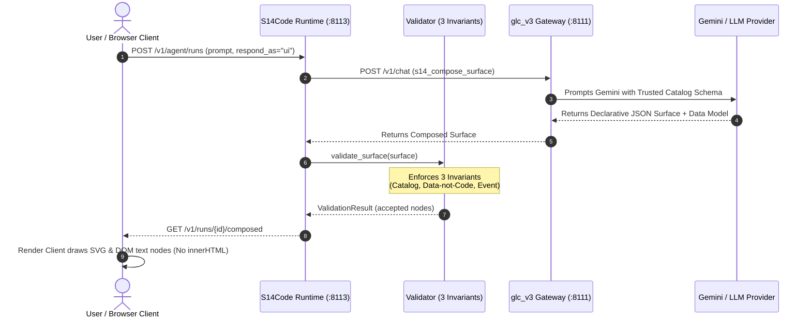
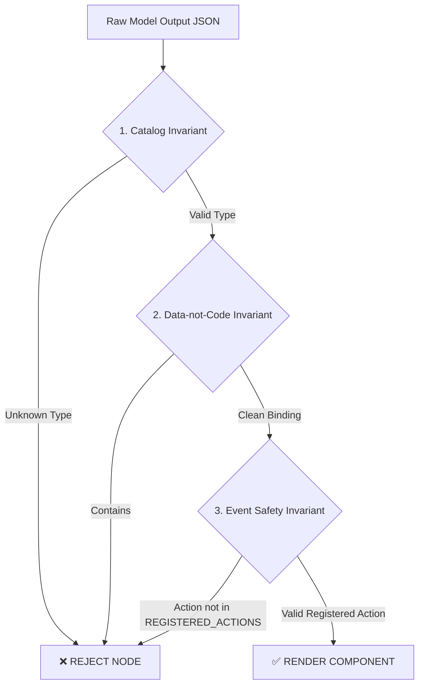

# 🎨 Session 14 Architecture & Generative UI Guide

> **The Core Guarantee**: AI Agents communicate through declarative, structured user interfaces validated against a closed component catalog. The LLM authors the structure, but **never executes code or raw HTML**.

---

## Executive Summary (Non-Technical)

In traditional AI applications, an AI assistant responds with paragraphs of plain text or markdown. **Session 14 introduces Generative UI (A2UI)** — a paradigm shift where the AI assistant answers by **composing interactive visual interfaces** (charts, tables, timelines, cards, approval buttons).

```
   ┌──────────────────┐           ┌──────────────────┐           ┌──────────────────┐
   │  User Prompt     │  ──────>  │ AI Model         │  ──────>  │ Interactive UI   │
   │  "Compare cities"│           │ Composes Surface │           │ Table, Charts,   │
   └──────────────────┘           └──────────────────┘           │ Taps & Action    │
                                                                 └──────────────────┘
```

### Key Differences at a Glance

| Feature | Traditional AI Chat | Session 14 Generative UI |
| :--- | :--- | :--- |
| **Response Format** | Wall of plain text or raw markdown | Rich, interactive UI components |
| **Security Risk** | High risk of Prompt Injection / XSS | **Zero XSS**: Model output is data, never code |
| **User Action** | Reading text & typing back | Tapping buttons, sorting tables, interacting |
| **Data Binding** | Hardcoded text strings | Dynamic JSON Pointers (`{"$bind": "/pointer"}`) |

---

## System Architecture (Technical)

The Session 14 runtime operates across two decoupled services running locally:



---

## 🛡️ The Injection Wall: 3 Invariants

Every surface generated by the AI passes through [`s13code/ui/validator.py`](file:///c:/Users/bhamb/Downloads/EAG%20V3/Session14/S14Code/s13code/ui/validator.py) before reaching the client:



1. **Catalog Invariant**: Component `type` must exist in the closed 27-component catalog. Unknown types (e.g. `RawHtml`, `CustomScript`) are stripped.
2. **Data-not-Code Invariant**: No property string may carry HTML markup (`<script>`, `<div>`), inline event handlers (`onclick=`, `onerror=`), or executable script protocols (`javascript:`, `data:`). Bindings must be explicit JSON Pointers (`{"$bind": "/pointer"}`).
3. **Event Safety Invariant**: Buttons and interactive controls can emit **only registered actions** (`approve`, `reject`, `rerun`, `request_data`). Unregistered actions cannot cross back into the server graph.

---

## 🧩 Part 1 Catalog Contribution: `DualAxisChart`

Part 1 introduces a generic, domain-agnostic custom component to the catalog: **`DualAxisChart`**.

### 1. Component Specification ([`catalog.py`](file:///c:/Users/bhamb/Downloads/EAG%20V3/Session14/S14Code/s13code/ui/catalog.py))
```python
"DualAxisChart": ComponentSpec("DualAxisChart", {
    "title": PropSpec("text"),        # Chart title text
    "data": PropSpec("binding"),      # Pointer to array of objects in dataModel
    "xKey": PropSpec("text"),         # Category label key (X-axis)
    "barKey": PropSpec("text"),       # Primary numeric key (Vertical bars, Left Y-axis)
    "lineKey": PropSpec("text"),      # Secondary numeric key (Line plot, Right Y-axis)
    "barLabel": PropSpec("text"),     # Legend label for bars
    "lineLabel": PropSpec("text"),    # Legend label for line overlay
}, source="custom")
```

### 2. Client Render Engine ([`app.html`](file:///c:/Users/bhamb/Downloads/EAG%20V3/Session14/S14Code/s13code/ui/client/app.html))
The client renders `DualAxisChart` as pure SVG DOM nodes:
* `rect` elements for primary bar metrics (scaled to left max value).
* `polyline` and `circle` elements for secondary line metrics (scaled to right max value).
* `text` nodes for category X-axis labels.
* **100% Executable-Free**: Never uses `innerHTML` or string evaluation.

---

## 📦 What to Submit for Part 1

Your pull request / submission for Part 1 consists of **4 verifiable artifacts**:

1. **Catalog Registration**: [`s13code/ui/catalog.py`](file:///c:/Users/bhamb/Downloads/EAG%20V3/Session14/S14Code/s13code/ui/catalog.py) containing `DualAxisChart` in `COMPONENTS`.
2. **Client Render Implementation**: [`s13code/ui/client/app.html`](file:///c:/Users/bhamb/Downloads/EAG%20V3/Session14/S14Code/s13code/ui/client/app.html) containing `dualChart()` DOM generator.
3. **Captured Live Proof Script & JSON**:
   - [`proofs/harness_dualaxischart.py`](file:///c:/Users/bhamb/Downloads/EAG%20V3/Session14/S14Code/proofs/harness_dualaxischart.py)
   - Demonstrates Gemini composing `DualAxisChart` unprompted when asked a multi-metric prompt.
4. **Unit Test Suite**: [`tests/test_s14_part1.py`](file:///c:/Users/bhamb/Downloads/EAG%20V3/Session14/S14Code/tests/test_s14_part1.py) (All 124 tests passing).

---

## 🚀 How to Run Everything on Your Laptop

### Terminal 1: Gateway (`glc_v3` on port 8111)
```powershell
cd "c:\Users\bhamb\Downloads\EAG V3\Session14\glc_v3"
uv sync
uv run glc serve
```

### Terminal 2: Session 14 Runtime (`S14Code` on port 8113)
```powershell
cd "c:\Users\bhamb\Downloads\EAG V3\Session14\S14Code"
uv sync
$env:GLC_BASE_URL="http://127.0.0.1:8111"
$env:S14_GATEWAY_PROVIDER="gemini"
uv run s14code serve
```

### Browser URLs
* **Health Check**: [`http://127.0.0.1:8113/healthz`](http://127.0.0.1:8113/healthz)
* **Catalog Manifest**: [`http://127.0.0.1:8113/v1/catalog`](http://127.0.0.1:8113/v1/catalog)
* **Interactive UI App Shell**: [`http://127.0.0.1:8113/app`](http://127.0.0.1:8113/app)

---

## 🧪 Verification Commands

To run the complete proof suite locally:

```powershell
# Run S14Code test suite (124 tests)
cd "c:\Users\bhamb\Downloads\EAG V3\Session14\S14Code"
uv run pytest -q

# Run glc_v3 gateway test suite (244 tests)
cd "c:\Users\bhamb\Downloads\EAG V3\Session14\glc_v3"
uv run pytest -q
```
